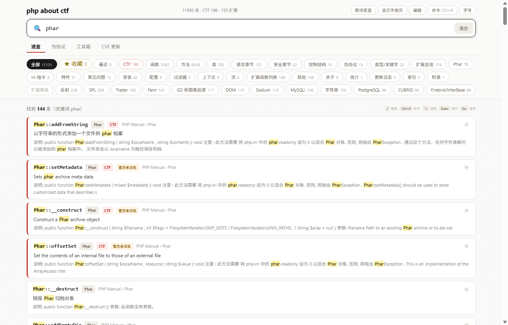
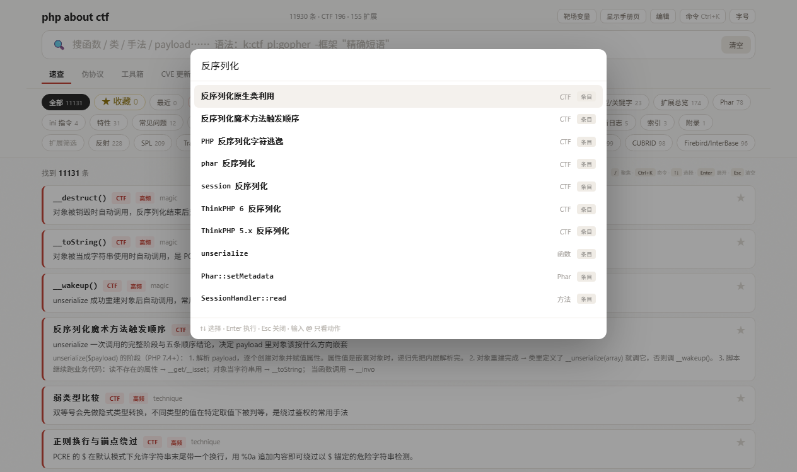
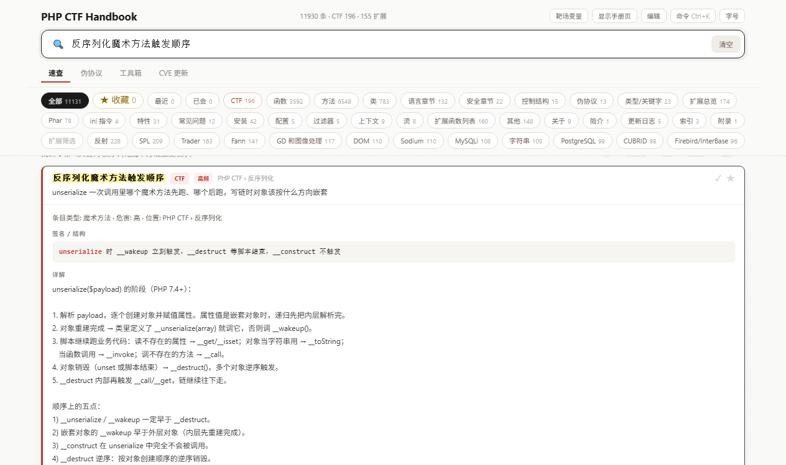
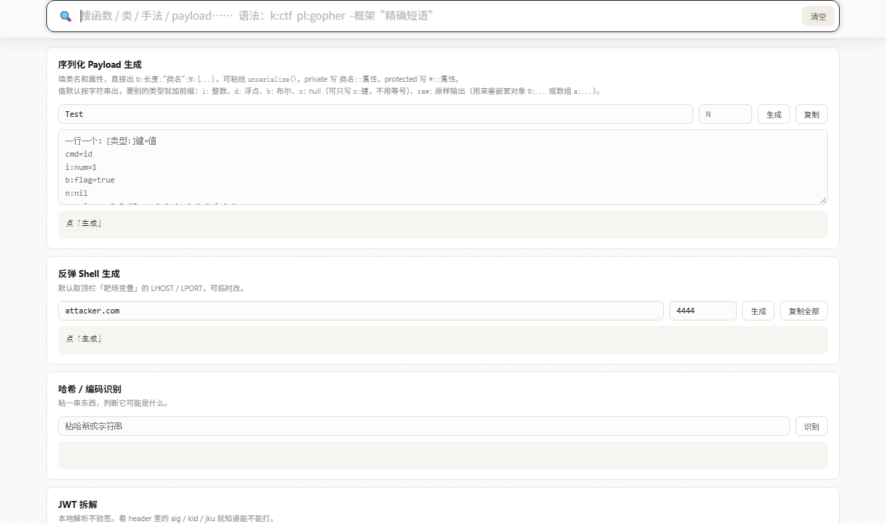

# PHP CTF Handbook

离线 PHP 速查手册，给 CTF Web 线下赛用。一个 13 MB 的 HTML 文件，双击就能用，不需要装 PHP，也不需要联网。

11,930 条条目：196 条 CTF 技巧、990 段可复制 payload，其余是 PHP 官方中文手册的索引。



## 快速开始

下载 `php-ctf-handbook.html`，双击。Windows、macOS、Linux 都一样，浏览器打开即可。

**Important**：Windows Defender 会把这个文件当可疑程序删掉，13 MB 的单页 HTML 容易触发启发式扫描。文件消失不是下载坏了，加个排除项，或者重新下一次。

## 仓库内容

```
php-ctf-handbook.html   成品，双击打开
README.md               这份说明
docs/                   截图
```

构建脚本和条目源文件没放进来。手册文本索引自 PHP 官方中文手册，CTF 条目手工整理，最后合并成一个 HTML。

要加自己的条目不用改文件：展开任意条目点「编辑」，改完导出 JSON 存着即可。

## 搜索

搜 `base64`，某段利用代码里的 `base64` 也会出来。索引到 payload 内部，不只是标题和描述。

`k:ctf` 按类型筛，`pl:base64` 只搜 payload，`-redis` 排除，`"精确短语"` 精确匹配，几个可以叠着用。`Ctrl+K` 是命令面板，跳条目、切视图、导出都在里面。



## 技巧

196 条 CTF 技巧，覆盖文件包含与伪协议、反序列化、SSTI 与框架、各类过滤绕过、XXE/JWT/SSRF、后渗透。

每条写三样：怎么判断、怎么打、payload 长什么样。判断那部分是从实际题目里总结的，不是手册的翻译。



## 工具箱

序列化 payload 生成、反弹 Shell、JWT 拆解、哈希识别、编码器，都在浏览器里算，不往外传数据。

序列化那块支持嵌套对象和类型前缀（`i:` `d:` `b:` `n:` `raw:`），private 属性写 `类名::属性`，长度按 UTF-8 字节算。`N` 可以手改，填比实际大的值就是 `__wakeup` 属性数绕过。



## CVE

接了 OSV。赛前拉一遍最近的漏洞，本地打法库会给它补上中文的判断方法和利用思路。

## 本地修改

收藏、笔记、最近查看都有。条目也能在页面里直接改，改动存在浏览器本地；导出 JSON 可以备份，换机器时再导入。

## 常见问题

**为什么不直接看 PHP 官方手册？**

官方手册讲函数怎么用，不讲怎么打。而且线下赛断网，手册打不开。

**13 MB 会不会太大？**

索引全部内联在这一个文件里，所以能拷到 U 盘带走，不用等下载。打开大约一秒。

**数据会过时吗？**

手册文本是打包时的快照，不会自己更新。CVE 那部分能联网拉新的，条目也能在页面里改完导出。

**为什么是 HTML，不是 PDF 或 App？**

PDF 搜不了 payload 里的符号，App 要装。HTML 双击就有，能搜、能复制、能改。

## 说明

仅用于 CTF 竞赛与授权渗透测试。手册文本索引自 PHP 官方中文手册，版权归 PHP Documentation Group；其余内容与代码 MIT。
